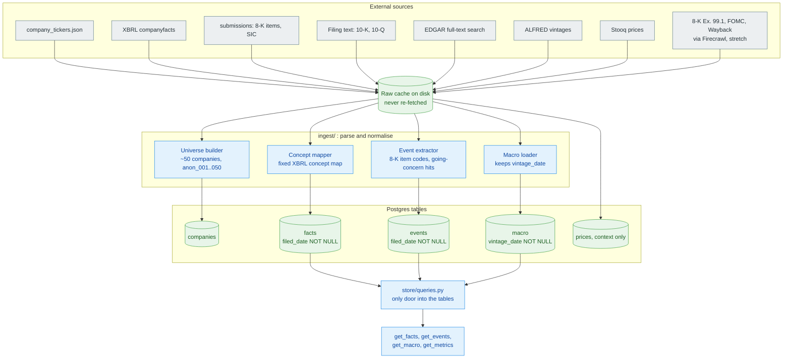
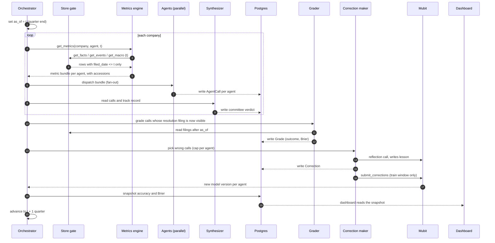
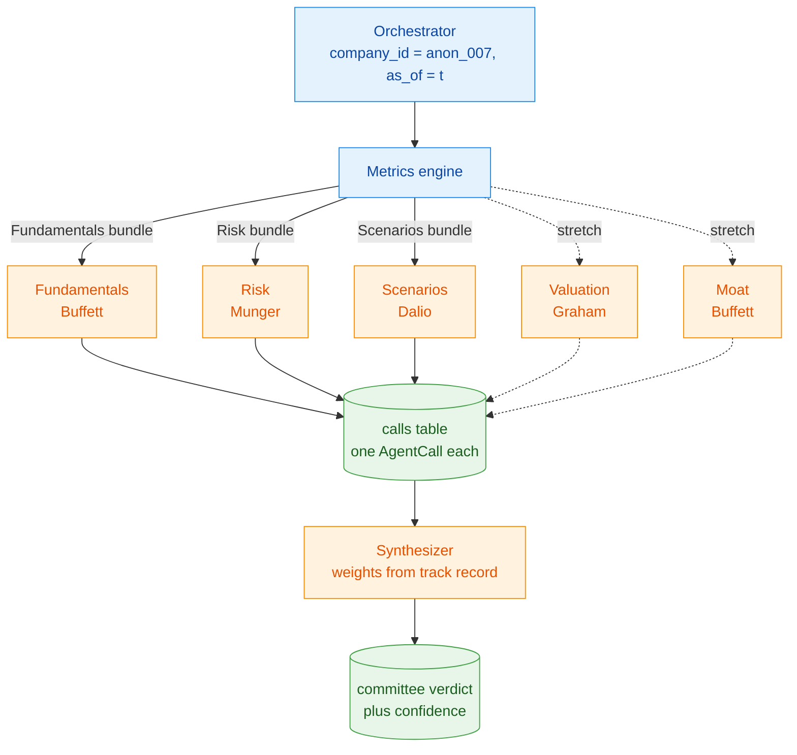
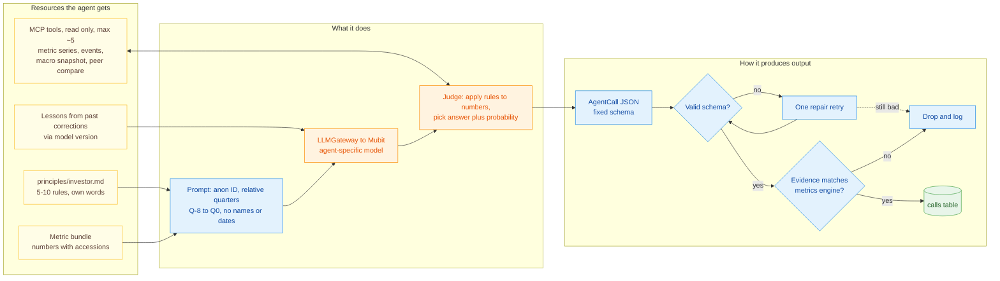
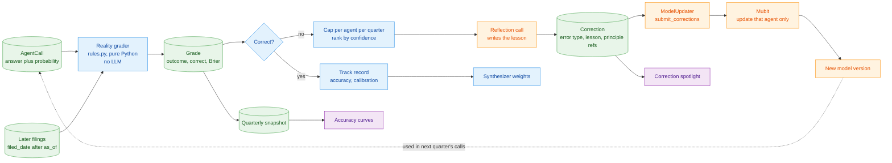
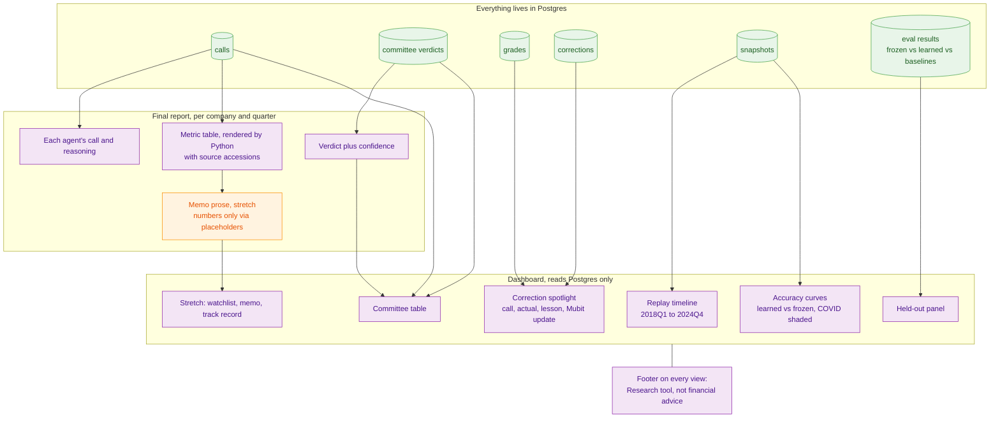

# Data Architecture: Compounding Minds

The whole system in diagrams, from raw data to the dashboard. Diagrams use Mermaid, so they render on GitHub and in the VS Code Markdown preview.

Companions: [ARCHITECTURE.md](ARCHITECTURE.md) (pattern and reasoning), [README.md](README.md) (full spec and schemas), [PROJECT.md](PROJECT.md) (overview).

**How to read the colours**

| Colour | Meaning |
|---|---|
| Blue | Python code. Deterministic. Produces every number |
| Orange | LLM step, always routed through Mubit |
| Green | Postgres tables (shared state) |
| Grey | External source |
| Purple | What the user sees |

---

## 1. The whole picture

```mermaid
flowchart LR
    classDef src fill:#eceff1,stroke:#607d8b,color:#263238
    classDef py fill:#e3f2fd,stroke:#1e88e5,color:#0d47a1
    classDef llm fill:#fff3e0,stroke:#fb8c00,color:#e65100
    classDef db fill:#e8f5e9,stroke:#43a047,color:#1b5e20
    classDef ui fill:#f3e5f5,stroke:#8e24aa,color:#4a148c

    subgraph S1["1. Sources"]
        SEC["SEC EDGAR<br/>XBRL facts, filings, 8-K items"]:::src
        MAC["FRED / ALFRED<br/>macro vintages"]:::src
        PRC["Stooq / Tiingo<br/>prices, context only"]:::src
        WEB["Firecrawl, stretch<br/>press releases, FOMC"]:::src
    end

    subgraph S2["2. Ingest, run once"]
        ING["ingest/<br/>fetch, cache raw, parse"]:::py
    end

    subgraph S3["3. Store"]
        DB[("Postgres<br/>facts, events, macro,<br/>every row has filed_date")]:::db
        GATE["store/queries.py<br/>THE gate: filed_date <= as_of"]:::py
    end

    subgraph S4["4. Numbers"]
        MET["metrics/<br/>Python computes every number,<br/>each traced to filings"]:::py
    end

    subgraph S5["5. Run one quarter"]
        ORC["Replay orchestrator<br/>plain code, sets as_of"]:::py
        AG["Specialist agents<br/>judge metrics, fixed JSON out"]:::llm
        SYN["Synthesizer<br/>committee verdict"]:::llm
    end

    subgraph S6["6. Learn"]
        GR["Reality grader<br/>pure Python vs later filings"]:::py
        COR["Correction maker<br/>plus reflection lesson"]:::llm
        MUB["Mubit<br/>per-agent model update"]:::llm
    end

    subgraph S7["7. Show"]
        OUT[("calls, grades,<br/>corrections, snapshots")]:::db
        DASH["Dashboard<br/>replay, curves, spotlight"]:::ui
        REP["Final report<br/>verdict plus memo"]:::ui
    end

    SEC --> ING
    MAC --> ING
    PRC --> ING
    WEB --> ING
    ING --> DB
    DB --> GATE
    GATE --> MET
    MET --> ORC
    ORC --> AG
    AG --> SYN
    SYN --> OUT
    AG --> OUT
    OUT --> GR
    GR --> COR
    COR --> MUB
    MUB -.->|"new model version"| AG
    OUT --> DASH
    OUT --> REP
```

One sentence: data goes in once, passes a single date gate, becomes numbers, becomes calls, gets graded against reality, and the misses retrain the agents.

---

## 2. Data pipeline: sources to the store

Runs **once, before the demo**. Raw responses are cached on disk before parsing, so a re-run never hits the network.

**Rules on this pipeline**

| Rule | Why |
|---|---|
| Every row carries `filed_date` (macro: `vintage_date`) | Lets the gate hide the future |
| A restatement is a new row, never an overwrite | At date `t` we return what was known at `t` |
| Nobody queries tables except `store/queries.py` | One place to test for leakage |
| Names and tickers stay in `companies` | Agents only ever see `anon_007` |
| Firecrawl output is dated pages only, no numbers | Numbers come from XBRL, never from an LLM |

---

## 3. Orchestrator: one quarter, step by step

The orchestrator is plain code. It always runs the same steps in the same order, which keeps replays deterministic.

**Hard guarantee:** a call is graded and corrected only once its resolution filing is visible at the current `as_of`. The loop never learns from the future.

---

## 4. Passing data to the agents

Agents are **independent**: none sees another agent's call before committing. That keeps errors attributable to one agent and one set of principles.

---

## 5. Inside one agent: resources, work, output

**What each agent has and does**

| Agent | Investor | Metrics it receives | Question it answers | Graded against |
|---|---|---|---|---|
| Fundamentals | Buffett | FCF, margins, ROIC, debt/EBITDA, 8-quarter slope | Do FCF margin and operating margin both improve next quarter? | Next 10-Q or 10-K |
| Risk | Munger | Interest coverage, current ratio, cash runway, dividends, auditor history, going-concern hits | Auditor change, dividend cut or going-concern note within 12 months? | 8-K items, XBRL dividends, 10-K text |
| Scenarios | Dalio | 5-year revenue growth distribution, cyclicality, macro regime | Bull, base or bear revenue over the next 4 quarters? | Actual revenue growth |
| Valuation (stretch) | Graham | Reverse-DCF implied growth, owner earnings yield | Is implied growth above what was delivered? | Revenue growth next year |
| Moat (stretch) | Buffett | Gross margin level and spread, R&D and SG&A intensity | Does gross margin hold within ±2 points for 4 quarters? | Next 4 filings |
| Synthesizer | Committee | Other agents' calls and their track record | Attractive, neutral or unattractive business outlook | Composite of graded outcomes |

Every agent: **judges, never computes.** All numbers arrive pre-computed from Python.

---

## 6. Grading, learning and the Mubit update

**Safeguards**
- The grader is not an LLM. It uses filed numbers.
- Corrections come from the **train window only** (2018 to 2022).
- Each learning agent has a **frozen twin** as a control.
- Lessons cite a principle or metric, never a company name.
- If Mubit is unavailable, `FakeModelUpdater` takes over and the UI labels it as a fallback.

---

## 7. Output: final report and dashboard

**Rules on output**
- The dashboard never calls a live API. It reads what the replay already stored.
- Every number in a report comes from the metrics engine. In memos the LLM writes prose around `{{metric:name}}` placeholders that Python fills, and a post-check rejects any other number.
- Names and tickers are mapped back only at render time, and only for the demo company.

---

## 8. Who builds which box

| Diagram section | Owner |
|---|---|
| 2. Ingest (fetch, cache, parse) | B |
| 2. Schema, concept map, store gate | A |
| 3. Orchestrator and replay | B |
| 4-5. Agents, principles, adapters | A |
| 6. Grader and correction selection | B |
| 6. Reflection prompt wording, Mubit client | A |
| 6. ModelUpdater calls, correction loop | B |
| 7. Dashboard | B |
| Held-out eval and baselines | A |

See [TASKS.md](TASKS.md) for the hour-by-hour split.

---

*Research tool, not financial advice.*
