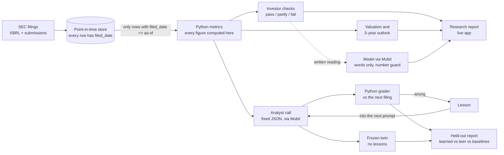

# Compounding Minds

**Type any US-listed company and get a research report built from its SEC filings, read through the habits of mind of five
legendary investors, from analysts that are graded against what the filings later said.**

Built for the **Night Shift: Mubit Hackathon** (London, 23-25 Oct 2026).

| | |
|---|---|
| **Live app** | https://compounding-minds.vercel.app (search any US-listed company; the first lookup takes 20 to 30 seconds) |
| **Demo video (2 min)** | VIDEO_LINK_HERE |
| **Run it yourself** | `pip install -r requirements.txt` then `make demo` (see [Run it](#run-it)) |
| **Code** | this repository; tests: `make test` (705 pass offline) |

---

## The 30-second version

**The problem.** Nobody reads fifty annual reports, and most "AI analyst" demos make claims nobody checks.

**What we built.** Two things that share one engine:

1. **A research report for any US-listed company, today.** It reads the company's SEC filings and shows growth, profit, cash,
   balance sheet, risks and the company's own plans (quoted word for word from its annual report). Five investors (Warren Buffett,
   Charlie Munger, Peter Lynch, Ray Dalio, Rakesh Jhunjhunwala) read the same figures as rule checks and each gives a call: would
   invest, would wait, or would not. A cash-flow valuation shows what growth today's price assumes, and a five-year outlook shows
   how likely the business is to be bigger.
2. **A scoreboard that grades AI analysts against reality.** The **Track record** tab replays 2018 to 2024 quarter by quarter on 50
   companies. At each quarter an analyst sees only filings public on that date and makes a call that can be checked (will
   free-cash-flow margin improve next quarter? which revenue bucket comes next?). Python grades it against the later filing. A
   wrong call becomes a lesson that goes into that analyst's next prompt, and an identical "frozen twin" that never learns is the
   control.

**Why you can trust it.**
- **Python computes every figure** and each one names the SEC filing it came from. Models only write words, behind a guard that
  drops any sentence containing a number the checks did not produce.
- **No look-ahead.** Every stored value carries the date it was filed, and one function (`store/queries.py`) hides anything filed
  after the as-of date, with a leakage test.
- **No price predictions, no advice.** Every call is about the business as filed; the page says it is research, not advice.

---

## How it fits the judging criteria

| Criterion | What we built | Where to see it | The honest limit |
|---|---|---|---|
| **Use of Mubit** | Every chat-model call goes through Mubit (`agents/gateway.py`, one task per analyst). A graded miss becomes a lesson the same analyst reads next time, and Mubit records those calls and trains small adapters on them. | Track record tab: the lesson, the same analyst asked again, the learned analyst beside its frozen twin, and a "Mubit adapters" panel. | Mubit has no API for submitting corrections, so the lesson loop is ours. No adapter has passed Mubit's test yet. Details in [How Mubit is used](#how-mubit-is-used). |
| **Usefulness** | A research task people repeat every time they look at a stock: read the filings, check the basics, see what the price assumes. Works on any US-listed company in about 30 seconds. | The live app. Search any company. | US-listed only for now (London and Europe are next); banks and insurers are only partly covered. |
| **Technical execution** | A point-in-time database gate, a grader with fixed rules, a held-out evaluation with a frozen twin, a number guard on every written sentence, 705 passing tests, and a deployed app. | `store/tests/test_leakage.py`, `eval/`, the live app. | The learned analysts did not beat their frozen twins in our run (see [Results](#results)). We say so rather than hide it. |
| **Demo** | A 110-second script and a live app that works with no keys for the Track record tab. | [docs/DEMO.md](docs/DEMO.md), the video above. | The Research tab needs internet access to the SEC. |

---

## What you can do in the app

Search a company, then use the five tabs:

| Tab | What it answers |
|---|---|
| **Overview** | Is it any good? The panel's verdict (for example "2 would invest, 3 would wait"), the headline figures, what stands out, a quick screen, the five investors with their calls (click one for their full analysis, or ask them a question), and the latest news. |
| **Financials** | How are the numbers? Six years in one chart, then growth, profit, cash, balance sheet and reinvestment, one question at a time, and the risk checks. |
| **Value and outlook** | What is it worth? The share price and multiples, a cash-flow valuation (bear, base and bull cases and what growth today's price assumes), the next five years, and what management says about its plans. |
| **Investor panel** | A 3D office where the five investors work through their checks, give their readings and argue where they disagree in front of a judge, then a final panel verdict. Every line is built from their own checks; with an ElevenLabs key each investor speaks in their own (AI) voice. |
| **Sources and data** | Where does it all come from? Every figure and check as a table with the filing behind it, and a CSV export. |

The separate **Track record** page holds the replay, the grading, the lessons and the held-out comparison.

---

## How it works



- **Point-in-time gate.** The replay and the back-test both see the world as of a date, and the live report uses today. One
  function enforces it, so look-ahead leakage has one place to be wrong and one test.
- **Rules, not opinions.** The investor checks are checklists distilled from each investor's published writing, in our own words,
  each with a source (`principles/`, `principles/SOURCES.md`). Each check is pass, partly, fail or unknown.
- **Fixed call format.** Analysts answer in the same JSON shape every time, so calls can be graded and compared.
- **Graded by what actually happened.** The grader (`grader/`) is rules over later filings. The one model in it only classifies
  going-concern text and never produces a number or a grade.

---

## How Mubit is used

- **Every chat-model call goes through Mubit** (`agents/gateway.py`, one task per analyst), so Mubit records it. Calls that must
  not train anything (the held-out evaluation, the frozen control, probes) are sent with recording off, and a ledger counts what
  is recorded (`python -m agents.ledger`).
- **A correction becomes a lesson the same analyst reads next time.** Mubit has no API for submitting corrections
  (`agents/MUBIT.md` records what we checked in its docs), so our correction loop stores each lesson and puts the latest ones in
  the analyst's next prompt. The "model version" in the app is that lesson counter, **not** a Mubit adapter version.
- **Mubit then trains small adapters on the recorded calls.** It tests each adapter against the provider model's own answers.
  Our first adapters scored well below Mubit's pass mark (best 77.8% against an 85% target, Fundamentals 13 to 17% against 95%,
  read from the console at 03:36 UTC on 25 Oct and copied into `agents/mubit_console.json`). The cause was on our side: the
  provider model disagreed with itself on the same prompt. We pinned the reply format, which raised its self-agreement on real
  prompts from 33 to 47% up to 95 to 98% (`python -m agents.agreement`), and sent 600 fresh real prompts to train on. **No
  adapter has passed yet**, and the Track record page shows Mubit's results next to this measure.
- **A frozen twin proves or disproves the lesson.** An identical analyst never gets lessons. The learned analyst is only said to
  help if it beats the twin on years and companies it never learned from.
- One call does not use the chat gateway: going-concern passages go to Mubit's Sapling verifier endpoint
  (`grader/sapling.py`), which is a verifier rather than a chat model. Its verdicts are cached.

---

## Results

All produced by the code in this repository, and reproducible.

**The 2018 to 2024 replay.** 50 companies, 28 quarters, claude-haiku-5-5; 322 lessons for these two analysts, learned from 2018
to 2022 on 40 companies. It is committed in `demo_data/runs_final`, and its held-out report is
`eval/reports/heldout_report.md`. On the held-out window (2023 to 2024), accuracy:

| Analyst and question | Learned | Frozen twin | Naive baseline |
|---|---|---|---|
| Fundamentals: free-cash-flow margin improves next quarter (n = 295) | 58.0% | 60.0% | 40.0% (always yes); 60.0% (base rate) |
| Scenarios: next-year revenue bucket (n = 392) | 57.9% | 63.8% | 51.5% (always base) |

**Read honestly: the learned analyst did not beat its frozen twin in this run** (Brier scores are level on Fundamentals and worse
on Scenarios), so we do not claim that accuracy climbs. The Scenarios analyst clearly beats the naive baselines, and the
Fundamentals analyst matches the base rate. What the run does show is the whole loop working end to end with every step visible:
call, grading from the next filing, lesson, the same analyst asked again, and the comparison with its twin. The Risk analyst is
left out of the headline because most of its stored grades in this run predate a grading fix; the app withholds its hit rate.

**Do the investor checks mean anything?** They were back-tested on 1,184 company-quarters through the date gate
(`python -m research.backtest`, summary in `research/evidence.json`):

- Companies passing few of **Munger's** failure checks had a dividend cut or auditor change in **13%** of cases, against **2%** for
  those passing most. The right direction, but modest, and these events are rare.
- **Buffett's** quality checks predicted free-cash-flow margins a year later (typical **14%** against **4%**) but said nothing
  about sales growth.
- Lynch, Dalio and Jhunjhunwala are **not** back-tested (they need historical prices we do not hold), and the app says so. No
  check tests whether a share price rose.

See section 9 of the spec below for the caveats.

---

## Run it

```bash
pip install -r requirements.txt         # Python 3.11 or newer; Node 20 or newer for the web app
cp .env.example .env                    # optional: see below
make demo                               # builds the web app and serves it at http://localhost:8000
```

- **No keys needed** for the **Track record** tab: it reads the committed replay and makes no network call.
- The **Research** tab reads live SEC filings, so it needs internet access and a `SEC_USER_AGENT` (your name and email) in `.env`.
  The written parts need `MUBIT_API_KEY` and `MUBIT_BASE_URL`; without them the figures still show but the prose is left out.
- Optional: `FIRECRAWL_API_KEY` adds news (words only, never figures); `ELEVENLABS_API_KEY` adds the investors' voices.
- Tests: `make test` (offline; database tests skip themselves when Postgres is not reachable).
- A copy is deployed on Vercel (`vercel.json`); the API serves the committed replay from `demo_data/runs_final`.

---

## Where things are

| Folder | What is in it |
|---|---|
| `research/` | The live company report: figures, investor checks, valuation, five-year outlook, news, chat |
| `agents/` | The analysts, the Mubit gateway, lessons, the replay runner, the agreement measure |
| `grader/` | Rules that grade a call from later filings |
| `store/` | The point-in-time database gate (`store/queries.py`; leakage test in `store/tests/test_leakage.py`) |
| `eval/` | The held-out evaluation: learned vs frozen twin vs baselines |
| `principles/` | Each investor's checkable rules in our own words, with sources |
| `ingest/` | SEC loaders and the 50-company universe |
| `api/`, `web/` | The FastAPI service and the React app (including the 3D investor office) |
| `docs/DEMO.md` | The 110-second demo script and the judge Q&A |

More detail: [ARCHITECTURE.md](ARCHITECTURE.md) (the agent pattern), [PROJECT.md](PROJECT.md) (overview), [TASKS.md](TASKS.md)
(who built what and where it stands), [agents/MUBIT.md](agents/MUBIT.md) (what Mubit's docs say, and what we still could not
confirm).

---

## Limits, and what is next

- **Mubit:** no correction API, and no adapter has passed yet. We could not get answers from Mubit on whether a passing adapter can
  serve live calls (listed in `agents/MUBIT.md`).
- **Coverage:** US-listed companies only today; banks and insurers only partly; UK and European listings are next.
- **Evidence:** only Buffett's and Munger's checks are back-tested; the price-based checks await historical prices.
- **Data freshness:** the SEC feed can lag a filing by a day or two; the page says which filing the figures come from and flags it
  when the feed is behind.
- **It is research, not advice.** No price targets, and nothing on the site tells you to buy or sell.

## Built during the event

Built by two people over the hackathon weekend: **Abdul Mateen** (content, data, the investor checks, valuation and outlook, the
research report and the investor panel) and **AhamadFalah** (ingestion, grading, replay, the Mubit integration and the web app).

Open-source libraries are used as dependencies (`requirements.txt`, `web/package.json`). `.claude/skills/` holds third-party Claude
Code skill packages (not project code, licences included where required). All other code was written during the event, 23 to 25
Oct 2026.

---

# Appendix: the original spec (written on day one, partly superseded)

The rest of this file is the plan we started from. Where it differs from the section above, the section above is right: the UI is
the React app in `web/` (not Streamlit), the replay result is above, Mubit has no correction API, and Graham is no longer on the
research panel. The roles "Person A" and "Person B" were the two builders' work split.

## Compounding Minds: full spec

A team of AI analysts that grades itself against reality and compounds from every mistake.

Built for **Night Shift: Mubit Hackathon** (London, 23-25 Oct 2026). Code freeze **Sun 25 Oct 10:00**.
Companion files: [PROJECT.md](PROJECT.md) (overview), [ARCHITECTURE.md](ARCHITECTURE.md) (agent pattern and flow), [system-map.html](system-map.html) (layered system architecture diagram), [architecture.html](architecture.html) (one quarter in time order, data pipeline, agent anatomy, learning loop), [user-journey.html](user-journey.html) (user inputs, outputs and dashboard screens) and [DATA_ARCHITECTURE.md](DATA_ARCHITECTURE.md) (same flow as Mermaid), [CLAUDE.md](CLAUDE.md) (rules for Claude Code), `TASKS.md` (who builds what).

---

## 0. The product: research any listed company, today

Type a company name or ticker. The app finds it (US exchanges today; London and Europe are next), reads its SEC filings and
builds a report with two tabs.

**Report tab**
- **The investors' take**, first: the panel's tally ("2 would invest, 3 would wait, 0 would not"), a box per investor with their
  face, and a click-open card of their checks and final call.
- **The numbers:** growth, profit, cash, balance sheet, reinvestment and R&D, risk checks, what the company says about its own plans,
  price and market multiples, each figure naming the filing it came from.
- **A 5-minute check** (debt to equity, return on capital, sales growth, promoter holding, dilution), **news** (Firecrawl),
  a **cash-flow valuation** under three stated growth cases with what today's price assumes, and **the next five years**: the chance
  the business is bigger, drawn from its own growth record, and value per share year by year beside the share price.

**Investor panel tab**
- The 3D office plays a prologue: each investor works through their own checks, then gives a reading. Under the animation a card per
  investor (face, name, the check they are on, their reading, their vote) follows along at a fixed height.
- Click a card, or the investor in the scene, for a pop-up in their own words: their call, why, the strongest points for and against,
  what they would watch next, every check folded away.
- **"Start the debate"** plays opening statements, face-offs between those who disagree most (with a judge) and a final verdict. Each
  line is said over the speaker's head in the scene, in the first person, and the transcript stays in a log below. With an
  ElevenLabs key each investor speaks in their own voice.

The panel is five investors: **Buffett, Munger, Lynch, Dalio, Jhunjhunwala** (Graham's code is kept but he is off the panel). Each
check is pass, partly, fail or unknown, and `decide()` turns them into invest, wait or avoid; price-minded investors wait when the
price is above even the optimistic case.

How it stays honest:
- **Python computes every figure** and each one names the SEC filings it came from. Models only write words: a paragraph per
  investor, checked so it cannot use a number the checks did not produce, and a choice among verbatim sentences from the 10-K. The
  first-person wording of the debate and pop-ups is a rewrite of the same checks; no new facts.
- **The investor lenses are the checklists in `principles/`**, turned into checks with their verified sources (`principles/SOURCES.md`).
- **The valuation is a plain cash-flow calculation with its assumptions on the page**, including the reverse question
  "what growth does today's price assume?". It is not a price target. The five-year outlook is a view of value, not a share-price forecast.
- **Every call is a reading of the evidence, never personal advice**, and the page says so.
- **The back-test (`python -m research.backtest`)** runs the Buffett and Munger checks at every quarter 2018-2023 for the 50 companies
  through the date gate and compares them with what happened over the next year. It is the evidence that the checks mean something
  (or the honest report that they do not): see the results section. Lynch, Dalio and Jhunjhunwala are not back-tested, and the page says so.
- **News comes from Firecrawl (`research/web.py`) and is words only.** Each summary line points at one article and may only use numbers that article contains; no financial figure ever comes from the web. It is fetched for today's report only (never for the past replay or back-test), cached for twelve hours (each search costs two credits), and the section is simply absent if Firecrawl is unavailable. Uses `FIRECRAWL_API_KEY` or the stored `firecrawl login`.
- **Data is judged fresh by content**: the filing list is refetched daily and the facts whenever a newer 10-K or 10-Q exists. The page says which filing the figures come from and flags when the SEC feed itself is behind.

Code: `research/` (`resolve`, `live`, `report`, `analysis`, `valuation`, `outlook`, `quick_check`, `dividends`, `text`, `web`, `narrative`,
`market`, `chat`, `voice`, `service`, `backtest`), API `GET /api/research/search`, `/api/research/company/{cik}`, `.../chat`,
`/api/research/evidence`, `/api/voice` and `/api/voice/status`; web `web/src/screens/Research.tsx`, the panel in
`web/src/components/` (`InvestorStage`, `InvestorCards`, `DebateLog`, `AnalysisPopup`, `Avatar`, `firstPerson`, `Outlook`) and
`web/src/scene/` (the 3D office: `ResearchScene`, `ThinkingCards`).
Not covered yet: non-US listings, and banks and insurers only partly (several measures do not apply to them).

The original replay (sections 1 to 15 below) is the evidence base for the learning loop and the Mubit story. Two places the pivot
changes the original non-goals: the app now reads live filings (no longer "historical and cached" only), and it shows a valuation
range with assumptions. It still gives no price target and no buy or sell instruction.

---

## 1. Concept

Each agent follows one legendary investor's principles (Buffett, Graham, Munger, Dalio). At a past date `t`, it sees only what was public on `t`, then makes a **checkable call** about a company's business outcomes. We grade the call against what later SEC filings actually reported. Wrong calls become **corrections**. **Mubit** records every call; our loop turns each correction into a lesson the same analyst reads next time (Mubit has no correction API, see `agents/MUBIT.md`), and a frozen twin shows whether that helped.

The demo's **Time Machine** replay runs 2018-2024 quarter by quarter. The audience watches accuracy climb, the COVID crash (2020) break the agents, then recovery as corrections accumulate.

**Why it's different:** most "AI analyst" demos make claims nobody checks. Ours is falsifiable, point-in-time honest, and visibly learns.

### Goals
1. Calls that are objectively gradable from filings, with no price predictions.
2. Zero look-ahead leakage, enforced in one place and tested.
3. A visible, reproducible loop: call, grade, correction, Mubit update, better call.
4. A live demo that runs entirely from a local cache in under the time limit.

### Positioning
This is a research-support and QA loop for analysts, not a replacement for an investment firm. It covers fundamental research, committee-style synthesis and systematic post-mortems. Stretch features (section 11b) add watchlist screening, memo drafting and a calibration track record to fit an analyst's workflow.

### Non-goals
- Portfolio sizing, trade execution, compliance workflows.
- Price targets, buy/sell advice, trading signals.
- Ingesting full investor books.
- Real-time data. Everything is historical and cached.
- Production-grade scale. ~50 companies is enough.

---

## 2. Hackathon constraints (hard)

| Rule | Consequence for design |
|---|---|
| All code written during the event | No pasted legacy code. Open-source libraries only. |
| Every LLM call routes through Mubit | One shared client, base URL set to Mubit, one adapter per agent. |
| Judged on: Mubit use, usefulness, execution, live demo | The correction to model update step must be **visible on screen**. |
| Code freeze Sun 25 Oct 10:00 | Backup demo video recorded before freeze. |

*(Resolved: Mubit has no correction or update API. `agents/MUBIT.md` records what we checked. The loop is described in section 10.)*

---

## 3. Architecture

```
            SEC EDGAR / FRED / prices
                      |
                 [ingest/]  --one-off, cached-->  [store/ Postgres]
                                                      |
                                       store/queries.py  (only gate: filed_date <= as_of)
                                                      |
                 +------------------------------------+-----------------+
                 |                                                      |
          [metrics/] Python computes ALL numbers                  [tools/] MCP servers
                 |                                                      |
                 +---------------------> [agents/] <--------------------+
                                  (judge only, fixed JSON out)
                                          |  every LLM call via Mubit
                                          v
                              [Synthesizer: committee verdict]
                                          |
   [replay orchestrator] --advances quarter, sets as_of--> calls stored in DB
                                          |
                                   [grader/] reads later filings
                                          |
                                    Correction records
                                          |
                                 Mubit update (per agent)
                                          |
                                 [dashboard/] replay UI
```

### Stack
Python 3.11, FastAPI, PostgreSQL, `edgartools`, `fredapi`, `pandas`, MCP Python SDK, React (`web/`) served by FastAPI (`api/`); Streamlit (`dashboard/`) was the first dashboard, LLM calls via Mubit.

---

## 4. Data layer (`ingest/` owner B, `store/` owner A)

### 4.1 Sources
| Source | Used for |
|---|---|
| SEC `company_tickers.json` | Universe, CIK mapping |
| XBRL `companyfacts` / `frames` | Financial facts with filing dates |
| SEC `submissions` | Filing list, 8-K item codes (e.g. 4.01 auditor change) |
| EDGAR full-text search | Going-concern and risk text |
| FRED + ALFRED | Macro series with **vintages** (what was known then, not revised values) |
| Tiingo or Stooq | Prices, used only for context metrics, never as a prediction target |

SEC rules: `User-Agent` header with a name and email, stay under ~10 requests/second, cache raw responses on disk before parsing.

### 4.1b Data sources by need

Access details change. Verify each at build time.

**Core (MVP)**
| Source | Gives us | Point-in-time field | Cost |
|---|---|---|---|
| SEC XBRL `companyfacts` / `frames` | Revenue, cash flow, margins, debt, dividends, R&D expense | `filed` on every fact | Free |
| SEC `submissions` | Filing list, 8-K item codes (4.01 auditor change), SIC code | Filing date | Free |
| SEC `company_tickers.json` | CIK and ticker map | None | Free |
| SEC filing documents (`edgartools`) | 10-K and 10-Q text: risk factors, going concern, MD&A, R&D section | Filing date | Free |
| EDGAR full-text search | Going-concern and risk phrases | Filing date | Free |
| FRED + ALFRED | GDP, unemployment, yield curve, credit spreads | ALFRED vintage date | Free key |
| Tiingo or Stooq | Prices, context only | Trading date | Free tier |

**Latest affairs and events (cheap additions, stretch)**
| Source | Gives us | Point-in-time field | Notes |
|---|---|---|---|
| 8-K Exhibit 99.1 | Earnings releases, guidance, deals | Filing date | Best option: dated, official, free |
| FOMC / Federal Reserve statements | Rate decisions, macro tone for Scenarios | Publication date | Small and clean |
| Wayback Machine snapshots | Historical company IR pages | Snapshot date | Proxy for "known then" |
| Company IR pages (live) | Press releases | Publication date, often unreliable | Pages are removed or edited; use only if the date is trustworthy |
| GDELT | News event index from 2015 | Article date | Noisy, names companies; skip unless time allows |

**R&D sources**
| Source | Gives us | Notes |
|---|---|---|
| XBRL `ResearchAndDevelopmentExpense` | R&D spend | Already in the core feed. Used by the Moat agent |
| 10-K R&D section | Qualitative pipeline text | Comes with SEC filing documents |
| USPTO patents (PatentsView / USPTO open data) | Patent grants per company | Assignee-to-company matching is messy; access has changed recently. Skip for MVP |
| ClinicalTrials.gov, openFDA | Trials, approvals, recalls | Sector-specific (pharma, biotech). Skip for MVP |

### 4.1c Data used by each agent and task

| Agent / task | Inputs | Graded or resolved by |
|---|---|---|
| Fundamentals | XBRL: operating cash flow, capex, revenue, operating income, debt, invested capital | Next 10-Q or 10-K (XBRL) |
| Risk | XBRL: interest expense, current assets and liabilities, cash, dividends. Submissions: auditor-change history. Full-text: going-concern hits | 8-K items, XBRL dividends, 10-K text |
| Scenarios | XBRL: 5-year revenue history. ALFRED: GDP, unemployment, yield curve, credit spread | Actual revenue growth (XBRL) |
| Valuation (stretch) | XBRL: growth, owner earnings. Prices for the reverse DCF (decision needed, see below) | Revenue growth over next year (XBRL) |
| Moat (stretch) | XBRL: gross margin, R&D, SG&A | Next 4 filings (XBRL) |
| Synthesizer | Stored calls and grades only | Composite of graded outcomes |
| Universe selection | `company_tickers.json`; sector from SIC code in `submissions` or chosen manually | n/a |
| Replay, dashboard, eval, screener, memos, calibration | Postgres only (`calls`, `grades`, `facts`, `events`) | n/a |

**Open data decisions:** (1) Valuation needs a market value for the reverse DCF, but prices are defined as context only. Decide before building it. (2) `peer_compare` needs a sector source (SIC from `submissions`). (3) Plain FRED values are revised after release; use ALFRED vintages only.

### 4.1d Firecrawl: where it helps

Firecrawl turns web pages into markdown and can crawl or map sites. It earns its place on **non-SEC pages**. For SEC filings use `edgartools`, which is structured and carries filing dates.

| Use | How | Fit |
|---|---|---|
| Build `principles/` | Scrape or parse public Berkshire shareholder letters, then write 5-10 rules per investor in our own words | Best fit. Development-time only, no leakage risk |
| Read Mubit docs | Scrape the docs we have so nobody guesses endpoints | Good, development-time |
| Press-release text | Crawl 8-K exhibits or IR pages into `events`, `filed_date` = publication date | Good for Risk. Keep only pages with a reliable date |
| Historical IR pages | Scrape Wayback snapshots, use snapshot date as `filed_date` | Medium |
| FOMC and macro statements | Crawl dated statements into `events` for Scenarios | Medium |
| Numeric extraction | Firecrawl extract/agent pulling figures from releases | **Do not use.** An LLM-extracted number breaks rule 1. Numbers stay in XBRL |

Constraints on every new source:
1. **Point-in-time.** Every row needs a trustworthy `filed_date`. If a page's date is unreliable, do not ingest it.
2. **Names leak.** News and press text contains company names, which defeats anonymization. Scrub names before text reaches a prompt, or use the source only for Python-side flags (for example "8-K item present").
3. **No live calls in the demo.** Scrape at ingest time and cache raw responses to disk. The demo reads Postgres only.
4. **Survivorship.** Scraped pages exist only if the company kept them, which biases Risk against failed companies. SEC filings do not have this problem.

**Recommendation:** MVP uses SEC (XBRL, submissions, filings, full-text), FRED/ALFRED and Stooq. Add 8-K Exhibit 99.1 as the cheap news source. Use Firecrawl first for the principles files. Then FOMC statements and Wayback IR pages if time allows. Skip GDELT, patents, clinical trials and FDA.

### 4.2 Universe
~50 US companies, chosen for: filings continuous 2017-2025, mix of sectors, a few that visibly suffer in 2020 (airlines, retail) and a few that don't. Frozen in `ingest/universe.json` early (Hour 3). Each gets a stable alias `anon_001`...`anon_050`.

### 4.3 Tables (Postgres)

```
companies   (company_id PK 'anon_001', cik, ticker, name, sector)      -- ticker/name never leave store
facts       (id, company_id, concept, value, unit, period_start, period_end,
             fiscal_period, form, accession, filed_date NOT NULL)
events      (id, company_id, form, items[], filed_date NOT NULL, accession, text_ref)
macro       (id, series_id, value, obs_date, vintage_date NOT NULL)
prices      (company_id, date, close)                                   -- context only
calls       (call_id PK, run_id, agent, company_id, as_of, payload JSONB, created_at)
grades      (call_id FK, graded_at, outcome, correct bool, brier, evidence JSONB)
corrections (correction_id PK, call_id FK, agent, summary, payload JSONB, mubit_ref, applied_at)
runs        (run_id PK, kind 'train'|'heldout', config JSONB, started_at)
```

### 4.4 Point-in-time rule (the most important rule in the project)
- Every row has a `filed_date` (or `vintage_date` for macro).
- At as-of date `t`, only rows with `filed_date <= t` exist.
- Enforced **only** in `store/queries.py`. No agent, metric or tool queries tables directly.
- A fact restated later appears as a **new row** with its own `filed_date`; the older row stays. At `t` we return the latest row with `filed_date <= t` for that `(concept, period_end)`.
- Never filter or order by `period_end` to decide visibility.
- **Leakage test** (`store/tests/test_leakage.py`): for sampled `(company, concept, t)`, assert no returned row has `filed_date > t`; assert a known restatement is invisible before its filing date; assert macro returns the vintage valid at `t`.

### 4.5 Store interface (contract between A and B)

```python
get_facts(company_id: str, concept: str, as_of: date) -> list[Fact]
get_events(company_id: str, as_of: date, forms: list[str] | None = None) -> list[Event]
get_macro(series_id: str, as_of: date) -> list[Point]
get_metrics(company_id: str, agent: str, as_of: date) -> dict
```

`get_metrics` is implemented in `metrics/` on top of the three getters above. Person B can develop against stub JSON until this is live (section 12).

---

## 5. Metrics engine and tools (`metrics/`, `tools/`) : owner A

**No number comes from an LLM.** Python computes every metric. Agents read numbers and judge them.

| Agent | Metrics (all computed at `as_of`) |
|---|---|
| Fundamentals | FCF (TTM), FCF margin, operating margin, ROIC, debt/EBITDA, YoY and QoQ trends, 8-quarter slope |
| Valuation | Reverse DCF implied growth, owner earnings yield, historical growth CAGR, margin of safety proxy |
| Moat | Gross margin level, 4q std-dev, trend, R&D and SG&A intensity, pricing power proxy (margin vs revenue growth) |
| Risk | Interest coverage, current ratio, cash runway, dividend history, auditor-change history, going-concern keyword hits, leverage trend |
| Scenarios | Revenue growth distribution (5y), cyclicality (beta of revenue to macro), macro regime (FRED: GDP, unemployment, yield curve, credit spread) |

Each metric returns `{name, value, unit, as_of, inputs: [accession...]}` so any number in a prompt can be traced to filings.

### MCP tools
Thin MCP servers wrap `get_metrics` plus drill-downs:
- `get_metric_series(company_id, metric, n_quarters)`
- `get_recent_events(company_id, forms)`
- `get_macro_snapshot()`
- `peer_compare(company_id, metric)` : within sector, anonymized

Agents may call tools freely, **capped at ~5 calls per run**. Tools are read-only and go through `store/queries.py`.

---

## 6. Schemas (fixed)

Do not change these without telling the other person. Agents must emit exactly this shape every time, otherwise grading and Mubit updates break. Use Pydantic models in `schemas/` (shared package, either person may edit this directory, tell the other).

### 6.1 AgentCall

```json
{
  "call_id": "uuid",
  "run_id": "uuid",
  "agent": "fundamentals | valuation | moat | risk | scenarios | synthesizer",
  "company_id": "anon_007",
  "as_of": "2019-06-30",
  "horizon": "next_quarter | 4_quarters | 12_months",
  "claim": {
    "type": "binary | bucket | numeric_band",
    "question_id": "fcf_margin_improves_next_q",
    "answer": "yes | no | bull | base | bear | ...",
    "probability": 0.68
  },
  "confidence": 0.68,
  "reasoning": ["max 5 short bullets, each citing a metric name"],
  "evidence": [{"metric": "fcf_margin_ttm", "value": 0.142, "as_of": "2019-06-30"}],
  "principles_used": ["buffett.03", "buffett.07"],
  "tool_calls": 3,
  "model": "mubit/<agent-model-version>"
}
```
`probability` is the probability the stated `answer` is correct, in [0,1]. `evidence` values must match what the metrics engine returned (checked at parse time; mismatch rejects the call).

### 6.2 Grade

```json
{
  "call_id": "uuid",
  "graded_at": "datetime",
  "resolution_date": "2019-10-31",
  "outcome": "yes | no | bull | base | bear | unresolvable",
  "correct": true,
  "brier": 0.1024,
  "evidence": [{"accession": "0000320193-19-000119", "concept": "...", "value": 0.151}]
}
```
`unresolvable` (missing filing, delisting) is excluded from accuracy and logged.

### 6.3 Correction

```json
{
  "correction_id": "uuid",
  "call_id": "uuid",
  "agent": "fundamentals",
  "company_id": "anon_007",
  "as_of": "2019-06-30",
  "predicted": {"answer": "yes", "probability": 0.68},
  "actual": {"outcome": "no", "evidence": [...]},
  "error_type": "overconfident | missed_regime | wrong_signal | ignored_metric",
  "lesson": "Agent weighted FCF trend and ignored rising capex intensity. Rule: when capex/revenue rises 3 quarters running, discount FCF improvement calls.",
  "principle_refs": ["buffett.03"],
  "inputs_snapshot": {"metrics": {...}, "reasoning": [...]}
}
```
`lesson` is generated by a separate "reflection" LLM call (via Mubit), given the call, the actual outcome and the metrics. It must reference a principle or a metric, not company names.

---

## 7. Agents (`agents/`, `principles/`) : owner A (synthesizer: owner B)

All agents share one runner:
1. Load `principles/<investor>.md`.
2. Receive `company_id`, `as_of`, and pre-computed metrics from `get_metrics`.
3. May call MCP tools (max ~5).
4. Return one `AgentCall` (6.1). Invalid JSON gets one repair retry, then the call is dropped and logged.

Prompts contain only `company_id` (anon) and metrics. **No names, no tickers, no dates beyond `as_of` relative framing.** Mask years where possible (use "Q-8 ... Q0").

### 7.1 Agent definitions

| Agent | Investor | Question (`question_id`) | Answer type | Resolved by |
|---|---|---|---|---|
| Fundamentals | Buffett | `fcf_margin_improves_next_q`: FCF margin and operating margin both higher in next reported quarter vs latest reported | binary | Next 10-Q (or 10-K for Q4) |
| Valuation | Graham | `implied_growth_above_delivered`: reverse-DCF implied growth is above growth actually delivered over next 12 months | binary | Revenue growth in filings over next year |
| Moat | Buffett | `gross_margin_holds_2pts`: gross margin stays within ±2pts of current across next 4 quarters | binary | Next 4 filings |
| Risk | Munger | `distress_event_12m`: any of auditor change (8-K 4.01), dividend cut (>=25% reduction), going-concern language in the next 12 months | binary | 8-K item codes, XBRL dividends, 10-K text search |
| Scenarios | Dalio | `revenue_bucket_next_4q`: bull / base / bear for next-4-quarter revenue vs trailing | bucket | Actual revenue growth, bucketed |
| Synthesizer | Committee | `committee_verdict`: attractive / neutral / unattractive business outlook with confidence | bucket | Composite of the graded outcomes (see 8.4) |

Bucket definitions for Scenarios are fixed and numeric, set once in `grader/config.py`: bear < 0% growth, base 0-10%, bull > 10% (tune on training window only, never on held-out).

### 7.2 Principles (`principles/<investor>.md`)
- 5-10 checkable rules per investor, **in our own words**, each with an ID (`buffett.03`) and a citation (Berkshire letter year, *The Intelligent Investor* ch. 20, etc.).
- No long quotes, no full-book ingestion.
- Format per rule: `id | rule | how to check with metrics | source`.
- Corrections can propose **new or revised rules**; Mubit updates apply them per agent (section 10).

### 7.3 Synthesizer
Takes the other agents' calls (not raw data), weighs them by each agent's trailing accuracy (from `grades`), and outputs the committee verdict with a calibrated confidence. MVP: weighted vote plus an LLM-written rationale. Stretch: **cross-examination round**, where agents challenge each other's evidence (max 1 round).

**Built (B):** cross-examination in `agents/cross_exam.py` (`python -m agents.synthesizer --cross-exam`): confidence only, shift capped at 0.15, originals untouched. Tool use in `agents/runner.py` + `agents/tools.py`: off unless a toolbox is passed, at most 5 calls, instructions in the user message only, tool values citable as evidence. Valuation and Moat agents are in `agents/specs.py`; Moat reads `principles/buffett_moat.md` so the Fundamentals prompt (also Buffett) never changes. Their stub metrics are in `store/stubs/` and their metric names are the contract for `metrics/`.

### 7.4 Mubit adapter (one per agent)
`agents/adapters/<agent>.py` wraps the single Mubit client with that agent's identity, so Mubit tracks each agent's model separately. Interface in section 10.

---

## 8. Replay and grading (`grader/`) : owner B

### 8.1 Replay orchestrator
```
for as_of in quarter_ends(2018Q1 .. 2024Q4):
    for company in universe:
        for agent in active_agents:
            call = agent.run(company, as_of)      # sees only filed_date <= as_of
            store(call)
    grade_resolved_calls(as_of)                   # grade calls whose resolution_date <= as_of
    corrections = make_corrections(newly_graded)
    mubit.apply(corrections)                      # per-agent model update
    snapshot_metrics(as_of)                       # accuracy, Brier, per agent, for dashboard
```
Key points:
- A call is graded only once its resolution filing is visible at the current `as_of`. This keeps the loop honest: the system never learns from the future.
- Replay is deterministic where possible (temperature 0, fixed seeds, cached LLM responses keyed by prompt hash) so the demo is reproducible.
- Full replay is run **offline before the demo** and stored. The live demo replays stored results step by step, with at least one live call-to-correction-to-update shown for real.

### 8.2 Reality grader
- Pure Python, no LLM. Resolves each `question_id` using rules in `grader/rules.py` against filings with `filed_date` after `as_of`.
- One exception: the Risk rule's going-concern check (`grader/risk.py`). Python finds passages with "going concern" / "substantial doubt"; Mubit's **Banyan Sapling** verifier judges them against a written policy (real doubt vs boilerplate). Sapling `supported` = yes, `violation` = no, `insufficient_information` / `inconsistent_context` = `unresolvable`; an `unsure` status uses the top label only when it holds a majority (>= 0.50, `grader/config.py`; retune on the training window). Verdicts are cached in `data/sapling_cache/`, so the demo replays them with no live calls. Auditor changes (8-K 4.01) stay pure Python; the dividend-cut check is still to add.
- Produces `Grade` (6.2). Computes Brier score `(p - outcome)^2` for binary, multiclass Brier for buckets.
- Logs `unresolvable` cases instead of guessing.

### 8.3 Correction maker
For every incorrect call, plus every correct call with confidence > 0.8 that was a "lucky" miss on the key metric (stretch), emit a `Correction` (6.3). The `lesson` comes from a reflection LLM call routed through Mubit. Rate-limit to avoid flooding: max N corrections per agent per quarter (default 10), prioritized by confidence of the wrong call.

### 8.4 Metrics tracked
- Per agent: rolling accuracy, Brier score, calibration curve, per-regime accuracy (pre-COVID, crash, recovery).
- Committee: verdict accuracy. The composite outcome for the synthesizer is "majority of the underlying graded outcomes favoured the verdict".
- Baselines: always-yes, base rate, and a no-learning copy of each agent (frozen at the start). The learning agent beating its frozen twin is the headline result.

---

## 9. Held-out evaluation (`eval/`) : owner A

Prevents the demo from just showing overfitting.
- **Split by time and by company.** Train window: 2018-2022. Held-out window: 2023-2024. Hold out ~10 companies across all years.
- Mubit updates are learned **only** from train-window corrections.
- Report accuracy and Brier on held-out for: (a) frozen agents, (b) learned agents, (c) baselines.
- Held-out results are generated once, before freeze, and shown as a single slide/panel. No tuning against them.
- Stretch: frontier-model comparison (same questions, a larger model with no learning), shown as a bar next to ours.

**Results: the investor checks, back-tested (Sat 24 Oct).** `python -m research.backtest` runs the Buffett and Munger checks of the research report at every quarter from 2018Q1 to 2023Q4 for the 50 companies, through the date gate, and compares them with what happened over the next twelve months (1,184 company-quarters; no model, repeatable; summary in `research/evidence.json`, shown in the app).

| Check | Passes most | Middle | Passes few | Rank correlation (all / one window per year / held-out companies) |
|---|---|---|---|---|
| Munger fit vs an auditor change or dividend cut within a year (share of cases) | 2.1% | 4.5% | 12.9% | -0.13 / -0.13 / -0.21 (held-out: 60 cases, 5 in the low group, not distinguishable from chance) |
| Buffett fit vs free-cash-flow margin a year later (median) | 14.4% | 11.1% | 4.4% | +0.28 / +0.32 / +0.27 |
| Buffett fit vs revenue growth over the next year (median) | 5.6% | 5.2% | 5.9% | -0.03 / +0.01 / -0.05 |

Read honestly: Munger's failure checks point the right way but only modestly. An earlier run showed 3% against 45% and a correlation of -0.27; that was an artefact, because both the check and the outcome mistook the timing of dividend payments (a payment slipping over a quarter-end) for a cut. With a cut required to last two quarters on both sides it shrank to 2% against 13%. Buffett's quality checks predict that cash margins persist (partly because the check measures cash margin), and say nothing about sales growth. Quarterly windows overlap, so the p-values overstate certainty; the one-window-per-year column is the cleaner read. Not tested: Graham, Lynch, Dalio and Jhunjhunwala (they need historical prices we do not hold), and no check tests whether a share price rose.

**Status (done).** `eval/` implements the split, the frozen twin, both baselines and the report. The final held-out report from the finished replay is `eval/reports/heldout_report.md` (summary and honest reading at the top of this file); it was produced offline from `demo_data/runs_final` with `python -m eval.run --from-replay demo_data/runs_final --tag final --agents fundamentals,scenarios`. `python -m eval.run` alone is an offline preview on stub metrics and is stamped NOT RESULTS.

---

## 10. Mubit integration

Our code depends on an interface, not on Mubit's API directly:

```python
class LLMGateway:                       # all LLM calls go through here -> Mubit base URL
    def complete(self, agent: str, messages: list, **kw) -> str: ...

class ModelUpdater:
    def submit_corrections(self, agent: str, corrections: list[Correction]) -> UpdateRef: ...
    def get_model_version(self, agent: str) -> str: ...      # stamped into AgentCall.model
    def status(self, ref: UpdateRef) -> UpdateStatus: ...
```

- **As built:** `MubitUpdater` stores each lesson and links it to the Mubit request ID of the reflection call that wrote it; the lesson is added to the analyst's next prompt. `FakeModelUpdater` is the offline fallback used by tests and previews, and is labelled as fallback in the UI.
- The dashboard shows, for a chosen correction: the original call, the actual outcome, the lesson, the Mubit update reference, and the agent's model version before and after, then the same company asked again in a later quarter.
- **Office-hours questions:** the answers we found are in `agents/MUBIT.md` (no correction API; per-task recording; training in the console). The ones we could not confirm are listed at the bottom of that file as unanswered.

---

## 11. Dashboard (`dashboard/`) : owner B

*(Superseded: the shipped UI is the React app in `web/`; `dashboard/` is the Streamlit version and its data layer.)* Reads only from Postgres, never calls live APIs.

| View | Content |
|---|---|
| Replay timeline | Slider/play button over quarters 2018Q1-2024Q4; shows current `as_of` |
| Accuracy curves | Rolling accuracy and Brier per agent, learned vs frozen twin, with COVID window shaded |
| Committee table | For a chosen company and quarter: each agent's call, confidence, reasoning bullets, synthesizer verdict |
| Correction spotlight | The call to actual to lesson to Mubit update path (the judging moment) |
| Held-out panel | Frozen vs learned vs baseline on 2023-2024 |
| Scoreboard (stretch) | "Legend scoreboard": which investor's rules are doing best now |

A disclaimer footer is always visible: "Research tool, not financial advice."

**Built:** `streamlit run dashboard/app.py`. Reads Postgres when `DATABASE_URL` is reachable, otherwise the JSONL tables in `data/runs` (`python -m eval.run --agents fundamentals,risk,scenarios,valuation,moat --curves --save data/runs`); force one with `DASHBOARD_SOURCE=postgres|<dir>`. All six views above are in, plus the corrections-per-quarter chart. Stub runs show a NOT RESULTS banner and the FakeModelUpdater is labelled as fallback. The synthesizer verdict reuses `agents/synthesizer.py` scoring, so no LLM is called. Data layer tests in `dashboard/tests/`.

---

## 11b. Analyst workflow layer (stretch)

Turns the call-grade-correct engine into something that fits an investment team's research workflow. Three features, all built **on top of** existing stores and schemas. None changes the MVP or the never-cut list. All rules in CLAUDE.md still apply: no LLM-generated numbers, point-in-time only, no price predictions, no buy/sell language.

### 11b.1 Watchlist screener (`screener/`, owner A)
- Input: a watchlist (subset of the universe) and an `as_of` date.
- Pure Python, no LLM. Ranks companies by **flags computed from `get_metrics`**: e.g. FCF margin slope turning negative, interest coverage below threshold, gross margin std-dev rising, going-concern keyword hit.
- Optionally ranks by the committee's latest calls (distress probability, scenario bucket) stored in `calls`.
- Output: `ScreenResult {company_id, as_of, flags: [{metric, value, threshold, accessions}], rank_score}`. Every flag is traceable to filings, like any metric.
- Thresholds are fixed in `screener/config.py`, tuned on the train window only.
- Framed as "needs analyst attention", never "buy/sell".

### 11b.2 Analyst memo drafting (`memos/`, owner B)
- For a chosen company and `as_of`, assemble a structured memo from **existing outputs only**: the metrics bundle, each agent's `AgentCall` (reasoning bullets, evidence), the synthesizer verdict, and recent events.
- The LLM (via Mubit `LLMGateway`) writes prose around the numbers. **It may not introduce numbers**: every figure in the memo must come from a `{{metric:name}}` placeholder the renderer fills from the metrics engine. A post-check rejects memos containing any numeric literal not produced by a placeholder.
- Sections: Business outlook summary, Key metrics (table rendered by Python), Agent views and disagreements, Risks and distress flags, What would change the view (referencing principles), Source accessions.
- Anonymized by default. Name/ticker mapping happens only at render time in the dashboard, and only for the demo's chosen company, never in the prompt.
- Footer on every memo: "Research tool, not financial advice."

**Built (B):** `memos/` (`python -m memos --company anon_001 --as-of 2019-06-30`). The drafter writes four prose sections using placeholders only; `check_prose` rejects any digit, unknown placeholder or buy/sell language, with one repair retry, then the memo renders without LLM prose.

### 11b.3 Calibration and track-record tracker (`grader/calibration.py`, owner B)
- Maintains a persistent track record per agent (and per principle ID used): accuracy, Brier, calibration curve, overconfidence gap (mean confidence minus accuracy), per-regime breakdown.
- Computed only from `grades`, as-of aware: at replay date `t` it includes only grades resolved by `t`.
- Feeds the synthesizer's weights (7.3) and a "stale principle" flag when a principle's rolling Brier degrades.
- Exposes `get_track_record(agent, as_of) -> TrackRecord`, used by the dashboard, memos and screener.

### 11b.4 Dashboard additions
| View | Content |
|---|---|
| Watchlist screen | Ranked table of flagged companies at the current `as_of`, click-through to metrics |
| Memo view | Generated memo for a chosen company and quarter, with metric table and source accessions |
| Track record | Per-agent and per-principle calibration curves and overconfidence gap |

### 11b.5 Out of scope, even in stretch
Portfolio sizing, trade execution, price targets, compliance workflows, real-time feeds. This stays a research-support tool.

---

## 12. Interfaces and parallel development

Person B must never be blocked on Person A. Day 1 deliverables:
- `schemas/` with Pydantic models for 6.1-6.3 (merged first, by Hour 2).
- `store/stubs/` with 5 hand-written stub JSON metric bundles per agent matching `get_metrics` output. B develops against `get_metrics_stub()`, then flips an env flag to the real store.
- `grader/` exposes `grade(call) -> Grade` with a stub rule set, so B can test the learning loop on fake outcomes.

Integration checkpoints: Hour 10 (real metrics for one company flow into one agent), Hour 20 (full vertical slice: one company, one agent, one quarter, graded and corrected), Hour 30 (full replay running).

---

## 13. Repo layout

```
agents/       runner, adapters/, one module per agent (A). synthesizer.py,
              correction_loop.py, cache.py, mubit_batch.py, offline.py     (B)
principles/   buffett.md, graham.md, munger.md, dalio.md                    (A)
eval/         held-out split, frozen twins, baselines, report generation    (A)
ingest/       SEC/FRED/price fetchers, raw cache, parsers (B). universe.json (A)
store/        schema.sql, queries.py (point-in-time gate), stubs/, tests/   (A)
metrics/      one module per agent's metric set                             (A)
tools/        MCP servers                                                   (A)
grader/       rules.py, grade.py, corrections.py, replay.py, calibration.py (B)
screener/     watchlist flags and ranking (stretch)                         (A)
memos/        memo assembly, placeholder renderer, number check (stretch)   (B)
dashboard/    Streamlit app                                                 (B)
schemas/      shared Pydantic models                                        (shared)
.env.example  keys listed, no values
```

---

## 14. Testing

Minimum tests (the project cannot demo without these):
1. **Leakage test** for `store/queries.py` (4.4).
2. **Grader rule tests**: one fixture per `question_id` with a known filing, asserting correct outcome, including a restatement case.
3. **Schema validation**: every stub and every real call parses against `AgentCall`.
4. **Metrics traceability**: each metric returns `inputs` accessions that exist in `facts`.
5. **Smoke test**: one company, one agent, two consecutive quarters, end to end including a correction.

---

## 15. Demo (3-4 min, adjust to the time limit)

1. **Hook (20s):** "A team of AI analysts that grades itself against reality."
2. **Setup (30s):** anonymized company, Buffett agent at 2019Q2, sees only what was public.
3. **The call (30s):** committee table, calls with confidence.
4. **Reality (30s):** next filing arrives, call graded wrong.
5. **Correction to Mubit (45s):** lesson text, Mubit update, new model version. **This is the judging moment.**
6. **Learning shown (30s):** same kind of case later, now right. Accuracy curve climbing.
7. **COVID (30s):** crash drops accuracy, recovery follows.
8. **Held-out (20s):** frozen vs learned vs baseline on unseen years.

Backup: a recorded video of the full flow, made before freeze. If live fails, play it.

---

## 16. Risks and mitigations

| Risk | Mitigation |
|---|---|
| Look-ahead leakage | Single gate, leakage test, anonymization, masked dates |
| LLM memorizes company outcomes | Anonymize, strip names/tickers, mask years, report held-out by company |
| Mubit has no correction API | Lessons go in the next prompt; frozen twin measures the effect; `FakeModelUpdater` for offline runs |
| SEC rate limits / slow ingest | Start ingest by Hour 3, cache raw, ~50 companies only |
| XBRL concept inconsistency across filers | Small fixed concept map with fallbacks; drop companies that don't map cleanly |
| Replay too slow for live demo | Precompute everything, replay stored results, show one live loop |
| Accuracy doesn't improve | Report honestly; show per-regime and calibration gains; frozen-twin comparison is still a result |
| Scope creep | Follow the cut list below |

---

## 17. Scope

**MVP (must ship):** Fundamentals, Risk, Scenarios + synthesizer + grader + Mubit correction loop + replay dashboard, ~50 companies.

**Stretch (in order):** Valuation, Moat, track-record tracker (11b.3), held-out frontier-model comparison, watchlist screener (11b.1), analyst memos (11b.2), cross-examination round, legend scoreboard, Firecrawl press releases as an extra event source.

**Never cut:** point-in-time store, reality grader, correction-to-Mubit loop, held-out eval, backup demo video.

---

## 18. Timeline (~37 hours, indicative)

| Hours | A: data and grading | B: agents and Mubit |
|---|---|---|
| 0-3 | Repo, Postgres schema, universe, start ingest | `schemas/`, stubs, Mubit client setup, ask office-hours questions |
| 3-10 | Facts/events ingest, `queries.py`, leakage test | Agent runner, Fundamentals agent on stubs, principles drafts |
| 10-20 | Metrics for MVP agents, grader rules, first grades | Risk + Scenarios, Synthesizer, reflection prompt, ModelUpdater |
| 20-30 | Replay orchestrator, full ingest QA, dashboard v1 | Correction loop with real Mubit, held-out eval harness |
| 30-34 | Dashboard polish, correction spotlight | Full replay run, baselines, held-out report |
| 34-37 | Record backup video, freeze checks | Tune demo script, README results section |

---

## 19. Open questions

1. *(Resolved: Mubit has no correction API; see `agents/MUBIT.md`.)*
2. *(Resolved: `ingest/universe.json`.)*
3. *(Resolved: React in `web/`.)*
4. How many corrections per agent per quarter before updates become noisy (start at 10, tune on train window).
5. Whether to include Valuation in MVP if Fundamentals/Risk/Scenarios finish early.

---

*Research tool, not financial advice.*
